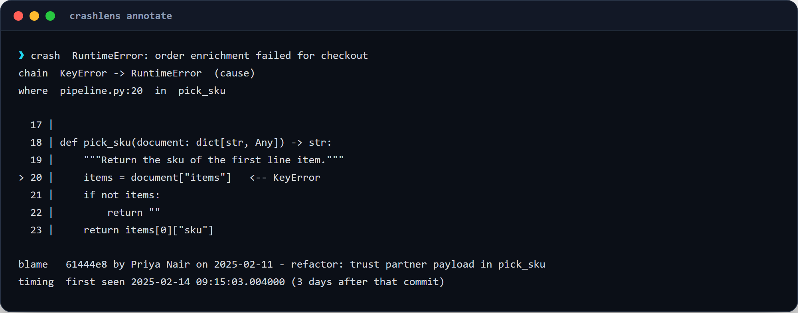
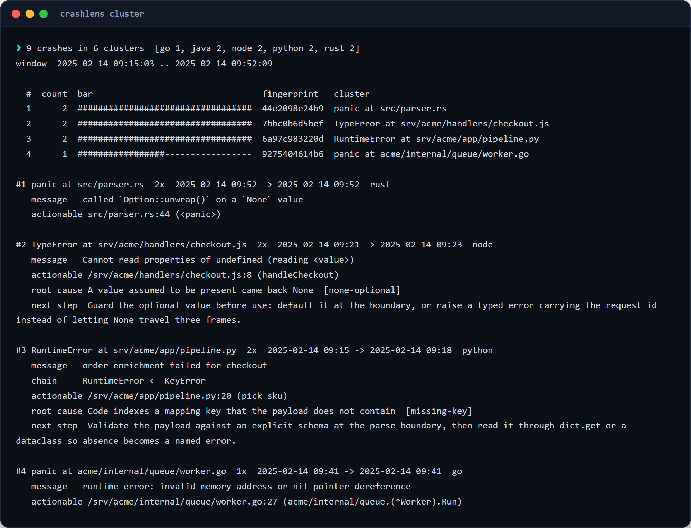
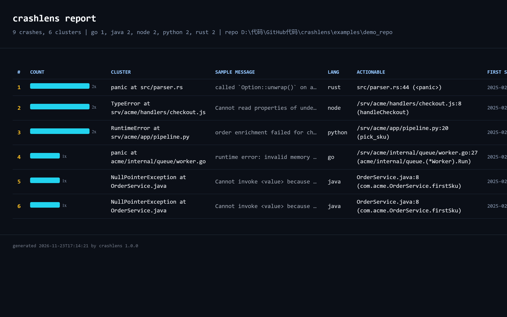
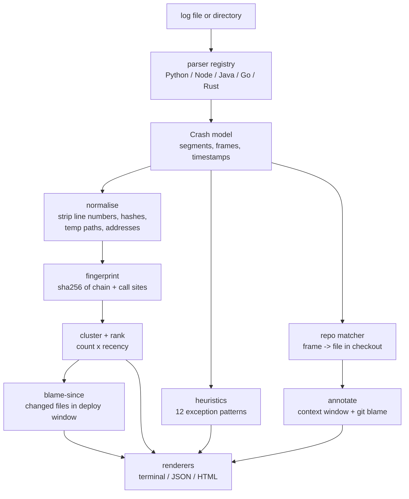

# crashlens

**English** | [简体中文](README.zh-CN.md)

**From stack trace to root cause in one command:** parse the traceback, cluster it against every other crash in the log, open the exact source line and blame the commit that introduced it.

[](https://github.com/kele-tao/crashlens/actions/workflows/ci.yml)




Real output of `crashlens annotate examples/python_error.log --repo examples/demo_repo`.
The crash is a `KeyError` wrapped by a `RuntimeError`; crashlens follows the cause
chain to `pipeline.py:20`, shows the source, and reports that the line was last
touched by Priya Nair three days before the first crash.

## The problem

A production log is 90% noise and 10% the same six bugs repeated. Reading it by
hand costs an incident's worth of time, and the two questions that actually
matter are rarely answered by a stack trace:

1. **Which bugs are here, and which one is burning the most requests right now?**
   A raw traceback has no notion of "the same crash as 40 minutes ago".
2. **Which deploy introduced it?** The traceback names a line, not a commit, and
   `git blame` does not read logs.

Existing tools solve half of this. Sentry-style platforms need a hosted service
and an SDK. `grep` finds the exception type but not the cluster, the recency or
the blame. crashlens is a single dependency-free command that reads the log you
already have on disk and answers both questions, offline.

## What it does

- **Parses five runtimes** into one model: Python (including chained exceptions
  with `During handling of the above exception` and `from` causes), Node.js
  (including `node:internal` async frames and bare `at Array.map (<anonymous>)`
  frames), Java (`Caused by:`, `... N more`, native frames), Go (`panic:` with
  goroutine frames and `created by`), and Rust (`thread 'main' panicked at ...`
  with or without a backtrace).
- **Fingerprints and clusters** crashes by language, exception chain and
  normalised call sites. Line numbers, build hashes, temp paths, pointer
  addresses and numeric message values are stripped, so the same bug from two
  hosts is one cluster.
- **Ranks clusters** by frequency and recency (`score = count * (1 + recency)`),
  reports first/last seen, and keeps one sample traceback per cluster.
- **Finds the actionable frame**: the deepest frame that resolves inside your
  checkout and is not in `site-packages`, `node_modules` or `vendor`.
- **Maps 12 exception patterns to concrete next steps** (None on an optional,
  missing mapping key, malformed JSON, connection reset/timeout, OOM, recursion
  depth, missing pandas column, encoding, missing file, permissions, DB
  constraints, index range) — `crashlens rules` prints the table.
- **Annotates the source** with a context window and arrows around the failing
  line, plus git blame: author, date, commit subject, and how many days after
  that commit the first crash appeared.
- **Correlates with a deploy**: `blame-since <sha>` lists the files changed in
  the window, the commits that touched them, and which crash clusters hit them.
- **Three output modes**: terminal, deterministic JSON, and a self-contained
  HTML report with inline SVG bars (no network, no JS, no external assets).

## Install

Not on PyPI yet; install from source. Python 3.10+ and zero runtime dependencies.

```bash
git clone https://github.com/kele-tao/crashlens
cd crashlens
pip install -e .
```

Already cloned and just want to run the tests? `pytest -q` works from the
repository root without installing anything (a root `conftest.py` puts `src/` on
`sys.path`). To use the `crashlens` command or `python -m crashlens` outside the
checkout, install with `pip install -e .` as above.

## Usage

### 1. Annotate: source line plus the commit that introduced it

```console
$ crashlens annotate examples/python_error.log --repo examples/demo_repo
crash  RuntimeError: order enrichment failed for checkout
chain  KeyError -> RuntimeError  (cause)
where  pipeline.py:20  in  pick_sku

  17 |
  18 | def pick_sku(document: dict[str, Any]) -> str:
  19 |     """Return the sku of the first line item."""
> 20 |     items = document["items"]   <-- KeyError
  21 |     if not items:
  22 |         return ""
  23 |     return items[0]["sku"]

blame   a56bbe2 by Priya Nair on 2025-02-11 - refactor: trust partner payload in pick_sku
timing  first seen 2025-02-14 09:15:03.004000 (3 days after that commit)
```

Note the chain line: the traceback's outermost exception is the boring
`RuntimeError`; crashlens walks to the root cause (`KeyError`) because that is
the frame a human has to edit. `--frame deepest` overrides the choice and
`--no-blame` skips git entirely.

### 2. Cluster: rank every crash in a directory

```console
$ crashlens cluster examples --repo examples/demo_repo --top 3
9 crashes in 6 clusters  [go 1, java 2, node 2, python 2, rust 2]
window  2025-02-14 09:15:03 .. 2025-02-14 09:52:09

  #  count  bar                                 fingerprint   cluster
  1      2  ##################################  44e2098e24b9  panic at src/parser.rs
  2      2  ##################################  7bbc0b6d5bef  TypeError at srv/acme/handlers/checkout.js
  3      2  ##################################  6a97c983220d  RuntimeError at srv/acme/app/pipeline.py

#1 panic at src/parser.rs  2x  2025-02-14 09:52 -> 2025-02-14 09:52  rust
   message   called `Option::unwrap()` on a `None` value
   actionable src/parser.rs:44 (<panic>)

#2 TypeError at srv/acme/handlers/checkout.js  2x  2025-02-14 09:21 -> 2025-02-14 09:23  node
   message   Cannot read properties of undefined (reading <value>)
   actionable /srv/acme/handlers/checkout.js:8 (handleCheckout)
   root cause A value assumed to be present came back None  [none-optional]
   next step  Guard the optional value before use: default it at the boundary, or raise a typed error carrying the request id instead of letting None travel three frames.

#3 RuntimeError at srv/acme/app/pipeline.py  2x  2025-02-14 09:15 -> 2025-02-14 09:18  python
   message   order enrichment failed for checkout
   chain     RuntimeError <- KeyError
   actionable /srv/acme/app/pipeline.py:20 (pick_sku)
   root cause Code indexes a mapping key that the payload does not contain  [missing-key]
   next step  Validate the payload against an explicit schema at the parse boundary, then read it through dict.get or a dataclass so absence becomes a named error.
```



`--json` emits the same data deterministically (sorted keys, two-space indent), and
`--html out/report.html` writes a single self-contained file:



### 3. Deploy correlation: what changed before the crashes started

```console
$ crashlens blame-since HEAD~1 examples --repo examples/demo_repo
deploy window  HEAD~1 -> HEAD (4a72acf)  1 commit, 1 file changed
  a56bbe2 2025-02-11 09:30 Priya Nair  refactor: trust partner payload in pick_sku

pipeline.py  a56bbe2 2025-02-11  1 cluster
     2x  6a97c983220d  RuntimeError at srv/acme/app/pipeline.py
         order enrichment failed for checkout

1 changed file appears in 1 cluster; 5 clusters unrelated to this window
```

The last line is the argument-settling one: five of six clusters do not touch
anything deployed in this window, so they are pre-existing known noise. The
sixth does, and it is the only one worth paging someone about.

### Parsing and the rule catalogue

```console
$ crashlens parse examples/python_error.log --limit 1 --max-frames 3
2 crashes parsed (showing 1)

#1 Python  2025-02-14 09:15  python_error.log:4
  root cause  KeyError: <value>
      /srv/acme/app/http/handler.py:118  handle_checkout
      /srv/acme/app/pipeline.py:28  enrich
      /srv/acme/app/pipeline.py:20  pick_sku
    wrapped by  RuntimeError: order enrichment failed for checkout
        /srv/acme/app/http/handler.py:118  handle_checkout
        /srv/acme/app/pipeline.py:29  enrich
        /srv/acme/app/pipeline.py:30  enrich
```

```console
$ crashlens rules
12 root-cause rules
  none-optional      AttributeError|TypeError|NullPointerException|nil pointer
                     message: NoneType|None|null|nil pointer|Cannot read propert
  missing-key        KeyError|NoSuchElementException
  json-shape         JSONDecodeError|JsonParseException|ValueError|SyntaxError|Unexpected token
                     message: json|unexpected token|expecting value|unexpected end
...
```

### Commands and flags

| Command | Purpose |
| --- | --- |
| `crashlens parse <path...>` | Parse tracebacks; `--json`, `--limit N`, `--max-frames N` |
| `crashlens cluster <path...>` | Fingerprint and rank; `--top N`, `--json`, `--html PATH`, `--repo PATH`, `--min-count N`, `--no-hints` |
| `crashlens annotate <path...>` | Source context and blame; `--repo PATH`, `--context N` (max 6), `--no-blame`, `--frame actionable\|deepest`, `--raw`, `--json` |
| `crashlens blame-since <sha> <path...>` | Deploy correlation; `--repo PATH`, `--json` |
| `crashlens rules` | Print the heuristic catalogue; `--json` |

Exit codes are part of the contract: **0** report produced, **1** nothing matched
(no crash records, or no cluster touching the deploy window), **2** usage error
(bad flag, missing input, unusable repository). User errors print one actionable
line instead of a traceback.

## How it works



**Parsing** is a single line-oriented pass with a per-runtime state machine. A
timestamped log line prefixes a traceback, so each crash inherits the timestamp
of the most recent stamped line; that is what makes first/last seen and recency
ranking possible on mixed logs. Frames are normalised to outermost-first: Java,
Node and Go print innermost-first and Python and Rust backtraces print
outermost-first, so the parser reverses where needed and every later stage can
assume "the last frame is where it blew up".

**Fingerprinting** hashes the language, the normalised exception chain and up to
six call sites per segment. The output is 12 hex characters and is stable across
machines: the same bug from a container, a laptop and a CI runner lands in one
cluster. Message values are redacted (`KeyError: <value>`), so two different
missing keys with identical call sites do share a cluster — a deliberate
trade-off, discussed below.

**Annotation and blame** resolve frame paths against a checkout by exact
relative path, then suffix, then basename, skipping vendored directories. The
resolved file is read, the failing line is marked with an arrow, and
`git blame --porcelain` is parsed for exactly that line.

## Design decisions

1. **One model, five parsers, no runtimes.** crashlens never imports the
   language it is analysing. A Go panic on a Python-only box is still parsed,
   and CI has no JDK/Go/Rust dependency. The cost is regex fragility on
   non-standard formats; the parser is test-driven against the five bundled
   real-shaped logs and silently skips blocks it does not recognise instead of
   crashing an incident tool.
2. **Fingerprints are shape-based, not value-based.** Line numbers are excluded
   so a refactor that moves a function 40 lines does not create a new cluster;
   quoted values are redacted so `KeyError: 'items'` and `KeyError: 'sku'` at
   the same line merge. The trade-off is real: two genuinely different missing
   keys at the same call site collapse into one cluster. The sample traceback of
   a cluster keeps the newest occurrence, so the distinction is one command away.
3. **Blame is anchored to the first crash, not the last.** The annotate output
   reports the number of days between the blamed commit and the *first* crash,
   because that is the interval that answers "did this deploy do it?". Anchoring
   to the last crash would make an old bug look freshly introduced just because
   it is still happening.

## Performance

`python benchmarks/run.py` generates a deterministic mixed log (Python single +
chained, Node, Java, Go, Rust) and times parse + cluster together, best of five
runs. Numbers below are from the committed `benchmarks/results.json`:

| crash records | lines | input size | crashes parsed | clusters | best | median | MB/s |
| ---: | ---: | ---: | ---: | ---: | ---: | ---: | ---: |
| 1000 | 7505 | 0.3 MB | 1000 | 6 | 33.4 ms | 34.9 ms | 8.9 |
| 1334 | 10013 | 0.39 MB | 1334 | 6 | 46.0 ms | 49.8 ms | 8.6 |
| 5000 | 37508 | 1.48 MB | 5000 | 6 | 186.8 ms | 200.7 ms | 7.9 |
| 10000 | 75005 | 2.95 MB | 10000 | 6 | 377.1 ms | 386.2 ms | 7.8 |
| 17000 | 127508 | 5.02 MB | 17000 | 6 | 1235.5 ms | 1270.4 ms | 4.1 |

A 5 MB, 127k-line log holding 17,000 crash records parses and clusters in 1.24 s;
a 10k-line log takes 46 ms. Cost is linear in lines and the parse phase
dominates, so a log file costs about 240 ns per line on this laptop
(Python 3.12.10, Windows 11, AMD64).

## Comparison

| | crashlens | Sentry | `grep` / manual reading | `python -m traceback` |
| --- | --- | --- | --- | --- |
| Works offline on a log file you already have | yes | no (needs a service + SDK) | yes | yes |
| Understands five runtimes in one log | yes | per-SDK | no | Python only |
| Clusters and ranks repeated crashes | yes | yes (hosted) | no | no |
| Source annotation + git blame from the log | yes | partial (needs source maps) | no | no |
| Deploy correlation (`blame-since`) | yes | release tracking, hosted | no | no |
| Cross-process aggregation, alerting, dashboards | **no** | yes | no | no |
| Runtime dependencies | 0 | heavy | 0 | 0 |

Sentry remains the right tool when you need alerting, cross-host aggregation and
a UI. crashlens is for the ten minutes before you open a dashboard: a log file,
a checkout, and one command.

## Roadmap

- Cross-file correlation by request id / trace id, so one request's output can be
  stitched across services.
- An `--ignore` rules file for known-noisy fingerprints, so CI can gate on "new
  cluster appeared since main".
- Python `--format json` input from `structlog`/JSON logs instead of only text.
- A `--watch` mode that tails a log and prints a cluster as soon as its count
  crosses a threshold.
- Optional `sourcemap` resolution for minified Node bundles (out of scope for
  v1.0; the current Node handler annotates the pre-bundled path as printed).

## Testing

```console
$ pytest -q
114 passed in 3.34s
$ python -m coverage run --source=src/crashlens -m pytest -q && python -m coverage report
TOTAL                           1528    151    90%
```

The suite covers all five parsers (including chained exceptions and the
`... N more` elisions), fingerprint stability, ranking determinism, the twelve
heuristics, repository matching, git blame, the blame-since correlation, every
documented flag, both non-zero exit codes, unicode input (CJK + emoji), hostile
HTML input and a 300-crash log. Tests never touch the network.

## Contributing

See [CONTRIBUTING.md](CONTRIBUTING.md). The short version: `pip install -e ".[dev]`,
`ruff check .`, `pytest -q`, and every parser change needs a fixture in
`tests/` and (if it changes a quoted number) a re-run of `benchmarks/run.py`.
Security policy in [SECURITY.md](SECURITY.md). Changelog in [CHANGELOG.md](CHANGELOG.md).

## License

MIT © 2026 kele. See [LICENSE](LICENSE).