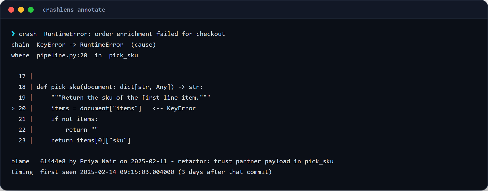
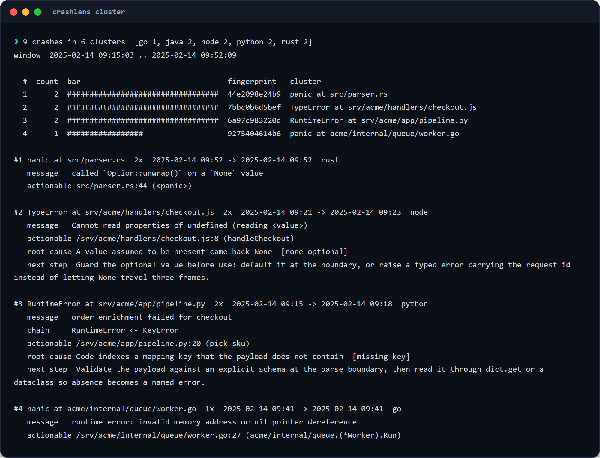
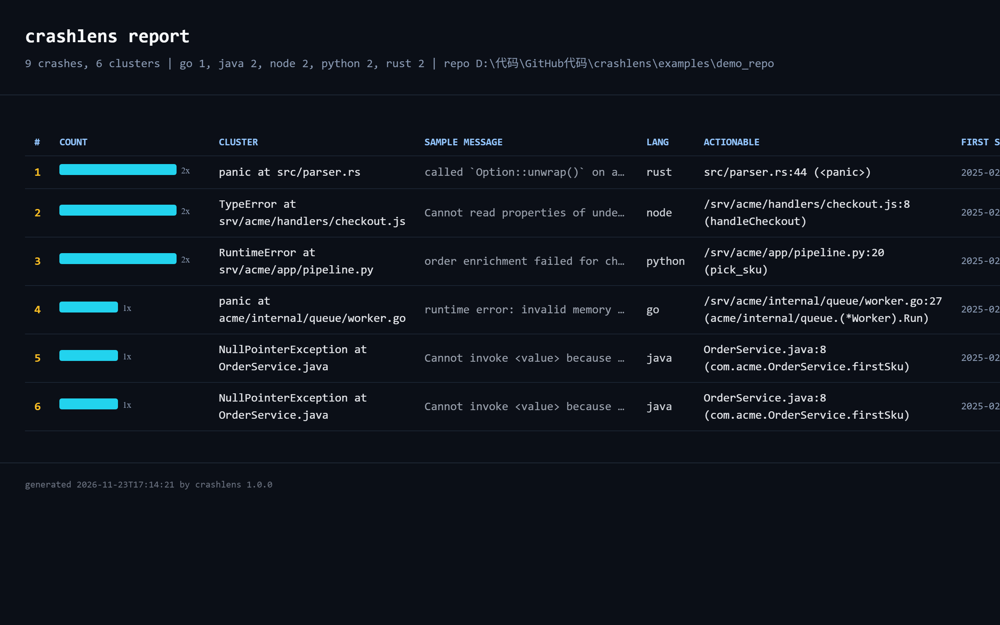
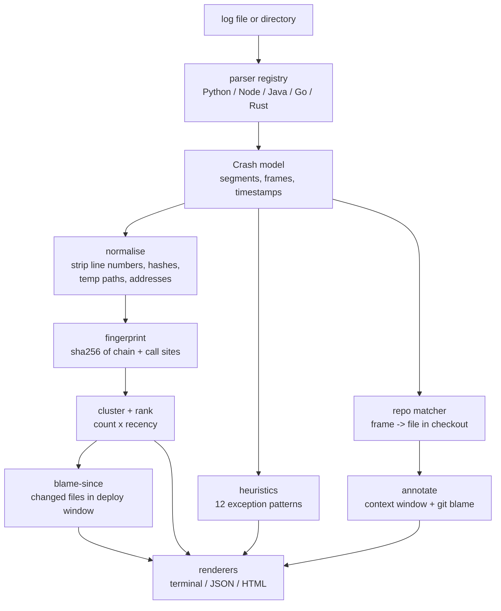

# crashlens

[English](README.md) | **简体中文**

**一条命令，从堆栈回溯走到根本原因：** 解析回溯，把它和日志里其余崩溃聚成一类，打开出错的那一行源码，并 blame 出引入它的那个提交。

[](https://github.com/kele-tao/crashlens/actions/workflows/ci.yml)




`crashlens annotate examples/python_error.log --repo examples/demo_repo` 的真实输出。
这次崩溃是一个被 `RuntimeError` 包裹的 `KeyError`；crashlens 顺着 cause 链走到
`pipeline.py:20`，显示对应源码，并指出这一行最后一次被 Priya Nair 改动，是在首次
崩溃的三天前。

## 问题

生产日志里 90% 是噪声，10% 是同样那六个 bug 在反复出现。手工读一遍要付出相当于一整个
故障事件的时间，而真正重要的两个问题，堆栈回溯偏偏很少能回答：

1. **这里到底有哪些 bug，此刻哪一个正在烧掉最多的请求？**
   一份原始回溯并没有「和 40 分钟前那次是同一个崩溃」这种概念。
2. **是哪次部署把它带进来的？** 回溯给出的是行号，不是提交，而 `git blame`
   也不会去读日志。

现有工具各自只解决了一半。Sentry 这类平台需要托管服务和 SDK；`grep` 能找到异常
类型，却给不出聚类、给不出最近性，也做不了 blame。crashlens 是一条零依赖的命令，
读你磁盘上已经存在的日志，离线把两个问题一起答了。

## 它能做什么

- **把五种运行时解析进同一个模型**：Python（包含 `During handling of the above exception`
  和 `from` 造成的链式异常）、Node.js（包含 `node:internal` 异步帧和裸的
  `at Array.map (<anonymous>)` 帧）、Java（`Caused by:`、`... N more`、native 帧）、
  Go（`panic:` 连同 goroutine 帧与 `created by`）、Rust（`thread 'main' panicked at ...`，
  带不带 backtrace 都行）。
- **按语言、异常链和归一化后的调用点做指纹并聚类**。行号、构建 hash、临时路径、
  指针地址以及消息里的数值都会被剥掉，因此同一个 bug 来自两台主机也只算一个簇。
- **给簇排序**：按频次与最近性（`score = count * (1 + recency)`），报告首次/最后出现
  时间，每个簇保留一份样本回溯。
- **找出可操作的那一帧**：在你的 checkout 里能解析到、且不在 `site-packages`、
  `node_modules` 或 `vendor` 里的最深一帧。
- **把 12 种异常模式映射到具体的下一步动作**（可选值为 None、映射键缺失、JSON 畸形、
  连接重置与超时、OOM、递归过深、pandas 列缺失、编码、文件缺失、权限、数据库约束、
  索引越界）——`crashlens rules` 会把这张表打印出来。
- **注释源码**：在出错行周围给出上下文窗口和箭头，并附上 git blame：作者、日期、提交
  标题，以及首次崩溃出现在那个提交之后多少天。
- **与部署做关联**：`blame-since <sha>` 列出窗口内被改动的文件、动过这些文件的提交，
  以及有哪些崩溃簇命中了它们。
- **三种输出模式**：终端、确定性的 JSON，以及单文件自包含的 HTML 报告（内联 SVG
  条形图，不联网、不用 JS、不引用外部资源）。

## 安装

尚未发布到 PyPI，请从源码安装。需要 Python 3.10+，零运行时依赖。

```bash
git clone https://github.com/kele-tao/crashlens
cd crashlens
pip install -e .
```

已经 clone 过、只想跑测试？在仓库根目录直接 `pytest -q` 就行，不用安装任何东西
（根目录的 `conftest.py` 会把 `src/` 放进 `sys.path`）。如果要在 checkout 之外使用
`crashlens` 命令或 `python -m crashlens`，请按上面的方式 `pip install -e .`。

## 用法

### 1. 注释：出错的那一行，以及引入它的提交

```console
$ crashlens annotate examples/python_error.log --repo examples/demo_repo
crash  RuntimeError: order enrichment failed for checkout
chain  KeyError -> RuntimeError  (cause)
where  pipeline.py:20  in  pick_sku

  17 |
  18 | def pick_sku(document: dict[str, Any]) -> str:
  19 |     """Return the sku of the first line item."""
> 20 |     items = document["items"]   <-- KeyError
  21 |     if not items:
  22 |         return ""
  23 |     return items[0]["sku"]

blame   a56bbe2 by Priya Nair on 2025-02-11 - refactor: trust partner payload in pick_sku
timing  first seen 2025-02-14 09:15:03.004000 (3 days after that commit)
```

注意 `chain` 那一行：回溯最外层的异常是那个平淡无聊的 `RuntimeError`；crashlens 一路
走到根因（`KeyError`），因为那才是人真正要动手改的那一帧。`--frame deepest` 可以覆盖
这个选择，`--no-blame` 则完全跳过 git。

### 2. 聚类：给目录里的每一次崩溃排序

```console
$ crashlens cluster examples --repo examples/demo_repo --top 3
9 crashes in 6 clusters  [go 1, java 2, node 2, python 2, rust 2]
window  2025-02-14 09:15:03 .. 2025-02-14 09:52:09

  #  count  bar                                 fingerprint   cluster
  1      2  ##################################  44e2098e24b9  panic at src/parser.rs
  2      2  ##################################  7bbc0b6d5bef  TypeError at srv/acme/handlers/checkout.js
  3      2  ##################################  6a97c983220d  RuntimeError at srv/acme/app/pipeline.py

#1 panic at src/parser.rs  2x  2025-02-14 09:52 -> 2025-02-14 09:52  rust
   message   called `Option::unwrap()` on a `None` value
   actionable src/parser.rs:44 (<panic>)

#2 TypeError at srv/acme/handlers/checkout.js  2x  2025-02-14 09:21 -> 2025-02-14 09:23  node
   message   Cannot read properties of undefined (reading <value>)
   actionable /srv/acme/handlers/checkout.js:8 (handleCheckout)
   root cause A value assumed to be present came back None  [none-optional]
   next step  Guard the optional value before use: default it at the boundary, or raise a typed error carrying the request id instead of letting None travel three frames.

#3 RuntimeError at srv/acme/app/pipeline.py  2x  2025-02-14 09:15 -> 2025-02-14 09:18  python
   message   order enrichment failed for checkout
   chain     RuntimeError <- KeyError
   actionable /srv/acme/app/pipeline.py:20 (pick_sku)
   root cause Code indexes a mapping key that the payload does not contain  [missing-key]
   next step  Validate the payload against an explicit schema at the parse boundary, then read it through dict.get or a dataclass so absence becomes a named error.
```



`--json` 以确定性的形式输出同一份数据（键排序、两空格缩进），
`--html out/report.html` 则写出一个单文件自包含报告：



### 3. 部署关联：崩溃开始之前究竟改了什么

```console
$ crashlens blame-since HEAD~1 examples --repo examples/demo_repo
deploy window  HEAD~1 -> HEAD (4a72acf)  1 commit, 1 file changed
  a56bbe2 2025-02-11 09:30 Priya Nair  refactor: trust partner payload in pick_sku

pipeline.py  a56bbe2 2025-02-11  1 cluster
     2x  6a97c983220d  RuntimeError at srv/acme/app/pipeline.py
         order enrichment failed for checkout

1 changed file appears in 1 cluster; 5 clusters unrelated to this window
```

最后一行才是定调的那一行：六个簇里有五个完全不碰本次窗口内部署的东西，属于早就存在
的已知噪声；第六个碰了，而它才是唯一值得半夜把人叫起来的那个。

### 解析与规则目录

```console
$ crashlens parse examples/python_error.log --limit 1 --max-frames 3
2 crashes parsed (showing 1)

#1 Python  2025-02-14 09:15  python_error.log:4
  root cause  KeyError: <value>
      /srv/acme/app/http/handler.py:118  handle_checkout
      /srv/acme/app/pipeline.py:28  enrich
      /srv/acme/app/pipeline.py:20  pick_sku
    wrapped by  RuntimeError: order enrichment failed for checkout
        /srv/acme/app/http/handler.py:118  handle_checkout
        /srv/acme/app/pipeline.py:29  enrich
        /srv/acme/app/pipeline.py:30  enrich
```

```console
$ crashlens rules
12 root-cause rules
  none-optional      AttributeError|TypeError|NullPointerException|nil pointer
                     message: NoneType|None|null|nil pointer|Cannot read propert
  missing-key        KeyError|NoSuchElementException
  json-shape         JSONDecodeError|JsonParseException|ValueError|SyntaxError|Unexpected token
                     message: json|unexpected token|expecting value|unexpected end
...
```

### 命令与参数

| 命令 | 用途 |
| --- | --- |
| `crashlens parse <path...>` | 解析回溯；`--json`、`--limit N`、`--max-frames N` |
| `crashlens cluster <path...>` | 指纹与排序；`--top N`、`--json`、`--html PATH`、`--repo PATH`、`--min-count N`、`--no-hints` |
| `crashlens annotate <path...>` | 源码上下文与 blame；`--repo PATH`、`--context N`（最大 6）、`--no-blame`、`--frame actionable\|deepest`、`--raw`、`--json` |
| `crashlens blame-since <sha> <path...>` | 部署关联；`--repo PATH`、`--json` |
| `crashlens rules` | 打印启发式规则目录；`--json` |

退出码是契约的一部分：**0** 表示产出了报告，**1** 表示什么都没匹配到（没有崩溃记录，
或者没有任何簇触及这次部署窗口），**2** 表示用法错误（参数不对、输入缺失、仓库不可用）。
用户侧的错误只会打印一行可操作的提示，而不是甩一整段回溯出来。

## 工作原理



**解析**是单遍、按行处理的，每个运行时一个状态机。带时间戳的日志行会给它后面的回溯
打上前缀，因此每次崩溃都继承最近一条带时间戳的行的时刻；这正是混合日志上能做首次/
最后出现统计和最近性排序的原因。帧会被归一化成「最外层在前」：Java、Node 和 Go 打印
时最内层在前，而 Python 与 Rust 的 backtrace 是最外层在前，所以解析器在需要的地方
做反转，后面每一个阶段都可以假定「最后一帧就是炸掉的地方」。

**指纹**对语言、归一化后的异常链，以及每个段最多六个调用点做哈希。输出是 12 个十六
进制字符，并且跨机器稳定：同一个 bug 来自容器、笔记本还是 CI runner，都会落进同一个
簇。消息里的取值会被脱敏（`KeyError: <value>`），所以两个键名不同、但调用点完全相同
的缺失键确实会共享一个簇——这是有意为之的取舍，下面会讨论。

**注释与 blame** 把帧里的路径解析到 checkout：先按精确相对路径，再按后缀，最后按
basename，并跳过 vendored 目录。解析到的文件会被读出来，出错的行走箭头标出，然后针对
那一行解析 `git blame --porcelain` 的输出。

## 设计取舍

1. **一个模型、五个解析器、不需要任何运行时。** crashlens 从不 import 它正在分析的
   语言。一台只有 Python 的机器照样能解析 Go panic，CI 里也不需要 JDK/Go/Rust 依赖。
   代价是对非标准格式的正则脆弱性；解析器由五个真实形态的日志驱动测试，遇到不认识的
   块会静默跳过，而不是让一个故障排查工具自己崩在事故现场。
2. **指纹基于形状，而不是取值。** 行号被排除在外，所以把函数挪动 40 行的重构不会产生
   新簇；引号里的取值会脱敏，所以同一行上的 `KeyError: 'items'` 和 `KeyError: 'sku'`
   会合并。这个取舍是实打实的：同一调用点上两个真正不同的缺失键会塌成一个簇。簇的
   样本回溯保留的是最新一次出现，所以想区分它们只差一条命令。
3. **Blame 锚定首次崩溃，而不是最后一次。** annotate 的输出报告的是被 blame 的提交与
   *首次*崩溃之间相隔的天数，因为回答「是不是这次部署干的」的正是这个间隔。若锚定到
   最后一次崩溃，一个老 bug 就会仅仅因为它还在发生而看起来像是刚引入的。

## 性能

`python benchmarks/run.py` 会生成一份确定性的混合日志（Python 单层 + 链式、Node、
Java、Go、Rust），并对 parse + cluster 一起计时，取五次运行中最好的一次。下面的数字
来自已提交的 `benchmarks/results.json`：

| 崩溃记录 | 行数 | 输入大小 | 解析出的崩溃 | 簇 | 最快 | 中位数 | MB/s |
| ---: | ---: | ---: | ---: | ---: | ---: | ---: | ---: |
| 1000 | 7505 | 0.3 MB | 1000 | 6 | 33.4 ms | 34.9 ms | 8.9 |
| 1334 | 10013 | 0.39 MB | 1334 | 6 | 46.0 ms | 49.8 ms | 8.6 |
| 5000 | 37508 | 1.48 MB | 5000 | 6 | 186.8 ms | 200.7 ms | 7.9 |
| 10000 | 75005 | 2.95 MB | 10000 | 6 | 377.1 ms | 386.2 ms | 7.8 |
| 17000 | 127508 | 5.02 MB | 17000 | 6 | 1235.5 ms | 1270.4 ms | 4.1 |

一份 5 MB、127k 行、装着 17,000 条崩溃记录的日志，解析加聚类用时 1.24 s；10k 行的日志
用时 46 ms。开销与行数呈线性，且解析阶段占主导，因此在这台笔记本上每行日志大约
240 ns（Python 3.12.10、Windows 11、AMD64）。

## 对比

| | crashlens | Sentry | `grep` / 人工阅读 | `python -m traceback` |
| --- | --- | --- | --- | --- |
| 在已有的日志文件上离线工作 | 是 | 否（需要服务 + SDK） | 是 | 是 |
| 一份日志里看懂五种运行时 | 是 | 按 SDK 区分 | 否 | 仅 Python |
| 对重复崩溃做聚类和排序 | 是 | 是（托管） | 否 | 否 |
| 从日志直接做源码注释 + git blame | 是 | 部分（需要 source map） | 否 | 否 |
| 部署关联（`blame-since`） | 是 | 发布跟踪，托管 | 否 | 否 |
| 跨进程聚合、告警、看板 | **否** | 是 | 否 | 否 |
| 运行时依赖 | 0 | 重 | 0 | 0 |

当你需要告警、跨主机聚合和 UI 时，Sentry 依然是正确的选择。crashlens 服务的是你打开
看板之前的那十分钟：一份日志文件、一个 checkout、一条命令。

## 路线图

- 按 request id / trace id 做跨文件关联，让一次请求的输出能跨服务拼接起来。
- 一份 `--ignore` 规则文件，用于已知的噪声指纹，这样 CI 就能拿「自 main 以来出现了
  新簇」当门禁。
- 支持来自 `structlog`/JSON 日志的 Python `--format json` 输入，而不只是文本。
- `--watch` 模式：tail 一个日志文件，某个簇的计数一越过阈值就立刻打印出来。
- 为压缩过的 Node bundle 提供可选的 `sourcemap` 解析（v1.0 不做；当前的 Node 处理按
  打印出来的打包前路径做注释）。

## 测试

```console
$ pytest -q
114 passed in 3.34s
$ python -m coverage run --source=src/crashlens -m pytest -q && python -m coverage report
TOTAL                           1528    151    90%
```

测试套件覆盖全部五个解析器（包括链式异常和 `... N more` 的省略形式）、指纹稳定性、
排序的确定性、十二条启发式规则、仓库匹配、git blame、blame-since 关联、每一个有文档
的参数、两个非零退出码、unicode 输入（中日韩字符 + emoji）、恶意 HTML 输入，以及一份
300 条崩溃的日志。测试从不访问网络。

## 参与贡献

见 [CONTRIBUTING.md](CONTRIBUTING.md)。简版：`pip install -e ".[dev]"`、`ruff check .`、
`pytest -q`；任何解析器改动都要在 `tests/` 里配一个 fixture，并且（如果改动了引用的
数字）重跑一次 `benchmarks/run.py`。安全策略见 [SECURITY.md](SECURITY.md)，变更记录见
[CHANGELOG.md](CHANGELOG.md)。

## 许可证

MIT © 2026 kele。见 [LICENSE](LICENSE)。
